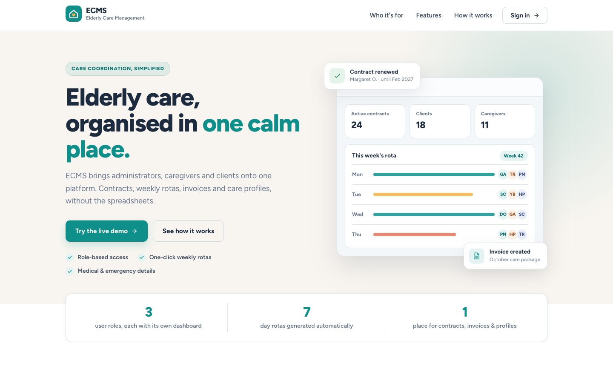
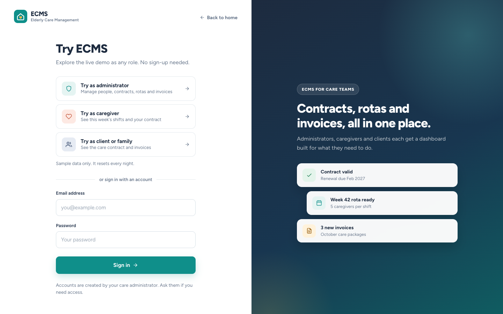
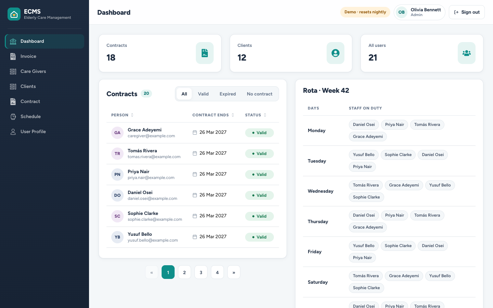
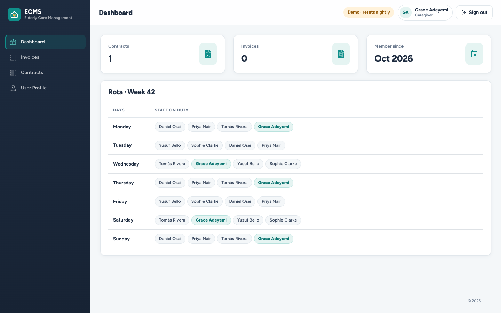
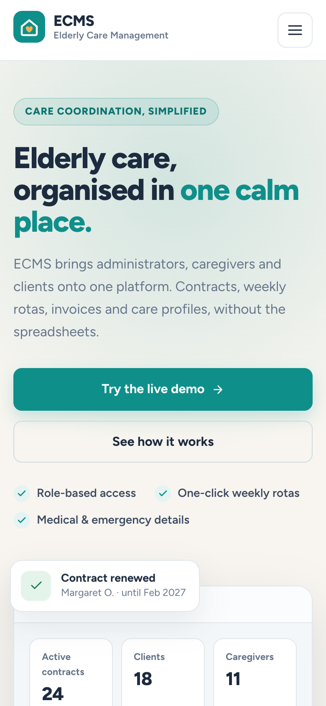

# Elderly Care Management System (ECMS)

[](https://github.com/helena-byte999/ecms/actions/workflows/ci.yml)

A full-stack web application that gives a care home one place to manage its clients, caregivers, contracts, weekly rotas and invoices, with a separate dashboard for administrators, caregivers and clients.

**Live demo:** _link coming soon_ · try it as an administrator, caregiver or client, no sign-up needed ([details](#try-the-demo))
**Stack:** React · Sass · Node.js · Express · MongoDB

> This started as an undergraduate team project. This repository is my copy, rebuilt and documented for my portfolio. See [Team & my role](#team--my-role) and the [requirements & design](docs/requirements.md) I wrote.

---

## Overview

ECMS is role-based. Everyone signs in to the same system and sees only what they need:

- **Administrator** manages clients and caregivers, contracts, the weekly rota and invoices.
- **Caregiver** sees their shifts (highlighted in the rota), their contract and their invoices.
- **Client** (an elderly resident or their family) sees their contract, invoices and profile.

## Features

- **Role-based dashboards** with server-side permission checks: people only ever see their own records
- **People**: client and caregiver profiles with medical notes, next of kin and emergency contacts
- **Deactivate / reactivate** accounts: records are kept, the person can't sign in and is left off new rotas
- **Contracts**: valid, expired and "no contract" at a glance, with end dates
- **Automatic weekly rota** from every active caregiver: shares differ by at most one shift, nobody works the same day twice, and caregivers per day is adjustable
- **Invoices** formatted in the care home's currency
- **Search, sortable columns and paging** across the whole list, not just the visible page
- **Responsive**: on phones, tables turn into readable cards
- **Demo mode**: sample data, one-click role sign-in, nightly reset

## Screenshots

| Homepage | Sign in (demo) |
|----------|---------|
|  |  |

| Admin dashboard | Caregiver dashboard (own shifts highlighted) |
|-----------------|----------------------------------------------|
|  |  |



_Screenshots use made-up demo data._

## Try the demo

On the sign-in page, choose **Try as administrator**, **caregiver** or **client**. You can also sign in normally:

| Role | Email | Password |
|------|-------|----------|
| Administrator | `admin@example.com` | `ecms-demo` |
| Caregiver | `caregiver@example.com` | `ecms-demo` |
| Client | `client@example.com` | `ecms-demo` |

Everything in the demo is sample data and resets every night (03:00 UTC), so feel free to add, change or deactivate things. The three demo accounts can't be deactivated or have their email, role or password changed, so they always work for the next visitor. The demo server sleeps when idle, so the first sign-in can take up to a minute.

## Tech stack

| Layer | Technology |
|-------|-----------|
| Frontend | React 17 (Create React App), React Router, reactstrap, Sass |
| Backend | Node.js 22, Express |
| Database | MongoDB with Mongoose 8 |
| Auth & security | JSON Web Tokens, bcrypt, role checks, helmet, rate-limited sign-in |
| Testing & CI | 72 API checks against a throwaway MongoDB, run by GitHub Actions on every push |
| Hosting | Vercel (frontend), Render (API), MongoDB Atlas (database) |

## Requirements, UML and data model

The [requirements & design document](docs/requirements.md) has the original 2022 requirements, use-case, ER and class diagrams. Next to them are updated diagrams of the system as built, and a table of which use cases are done. In short:

- **User**: name, email, role (admin / caregiver / client), status (active / on-leave / in-active), contact details, medical notes; contains **Contracts**, **Next of Kin** and **Emergency Contact**
- **Invoice**: client email, amount, type, description, date
- **Schedule**: week, dates, and the caregivers on duty each day

## Team & my role

This was a group project with four students. The original team repository is [NabsCodes/ecms](https://github.com/NabsCodes/ecms).

**My contributions:**
- **Frontend**: built and styled the React views and components
- **Database**: designed the MongoDB schemas and data relationships
- **UML**: produced the use-case, ER and class diagrams ([see them](docs/requirements.md#original-diagrams-2022))
- **Requirements documentation**: wrote the requirements specification ([see it](docs/requirements.md))

## Running locally

**Prerequisites:** Node.js 22 and a MongoDB database (local, or a free [MongoDB Atlas](https://www.mongodb.com/atlas) cluster).

```bash
git clone https://github.com/helena-byte999/ecms.git
cd ecms

# API
cd server
cp .env.example .env        # fill in the values (see below); set DEMO_MODE=true for sample data
npm install
npm run dev                 # http://localhost:5001

# Frontend (second terminal)
cd client
cp .env.example .env        # set REACT_APP_DEMO=true to show the demo buttons
npm install
npm start                   # http://localhost:3000
```

### Tests

```bash
cd server
npm test    # starts the real API against a throwaway MongoDB; no setup needed
```

## Deploying

1. **Database: MongoDB Atlas.** Create a free cluster and a database user. Under *Network Access*, allow `0.0.0.0/0`, because Render's addresses change. Copy the `mongodb+srv://…` connection string.
2. **API: Render.** *New → Blueprint*, then pick this repo. [`render.yaml`](render.yaml) sets everything up. Paste the Atlas string into `mongoURLProduction`; leave `FrontEndHostProduction` for step 4.
3. **Frontend: Vercel.** Import the repo and set **Root Directory** to `client`. Add `REACT_APP_BackEndHost` (your Render URL), `REACT_APP_DEMO=true` and `REACT_APP_CURRENCY`, then deploy.
4. Back in Render, set `FrontEndHostProduction` to your Vercel URL (no trailing slash) so the API accepts its requests.

### Environment variables

`server/.env`

| Variable | Description |
|----------|-------------|
| `LocalPort` | Port for the API locally, e.g. `5001` |
| `mongoURL` / `mongoURLProduction` | MongoDB connection strings for local and production |
| `jwtSecret` | Secret used to sign sign-in tokens (any long random string) |
| `FrontEndHostProduction` | Production frontend URL; the only other origin the API accepts |
| `ADMIN_EMAIL` / `ADMIN_PASSWORD` | Creates the first admin on startup if none exists (accounts can only be created by an admin) |
| `DEMO_MODE` | `true` for a public demo: sample data, one-click demo sign-in, nightly reset. **Never on a database with real care records.** |
| `DEMO_PASSWORD` | Password for the demo accounts (default `ecms-demo`) |
| `LOGIN_RATE_LIMIT` | Sign-in attempts allowed per IP per 15 minutes (default 20) |
| `ROTA_PER_DAY` | Default caregivers per day when generating a rota (default 5) |

`client/.env`

| Variable | Description |
|----------|-------------|
| `REACT_APP_BackEndHost` | URL of the API |
| `REACT_APP_DEMO` | `true` shows the "Try as …" buttons (needs `DEMO_MODE=true` on the API) |
| `REACT_APP_CURRENCY` | Currency for invoices, as an ISO code (`GBP`, `NGN`, `USD`…). Each deployment serves one care home, so it's set per deployment. Default `GBP`. |
| `REACT_APP_LOCALE` | Number and date formatting, e.g. `en-GB`, `en-NG`. Default `en-GB`. |

> Real secrets are never committed. Only `.env.example` templates are tracked, and `.env` is gitignored.

## License

No license was specified on the original project, so all rights remain with the original authors. This copy is published for portfolio and educational purposes.
