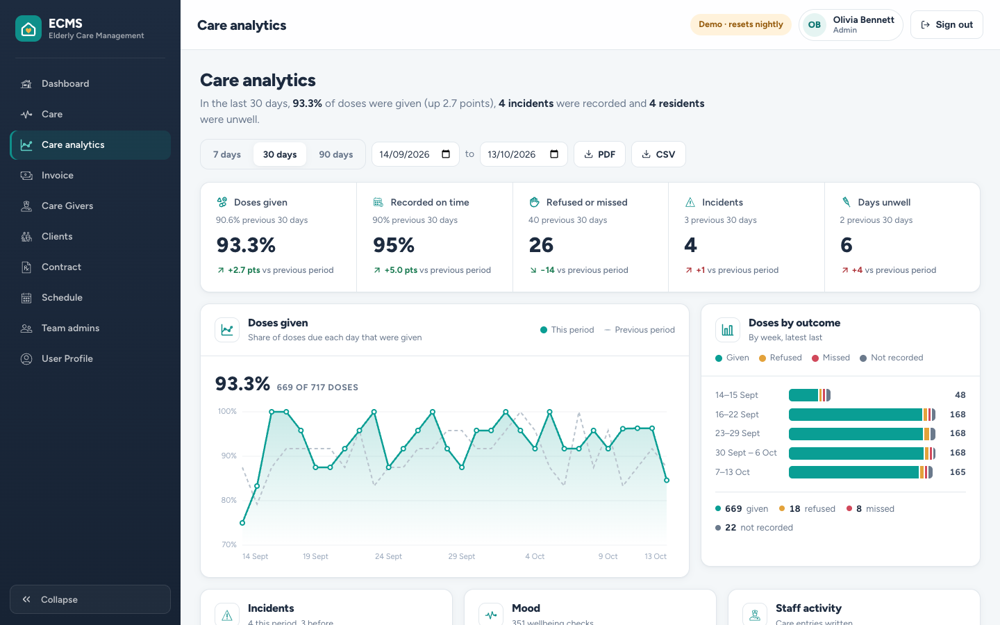
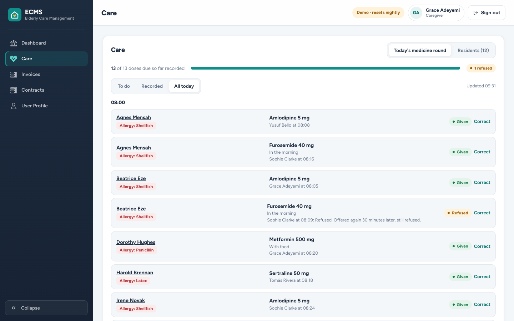
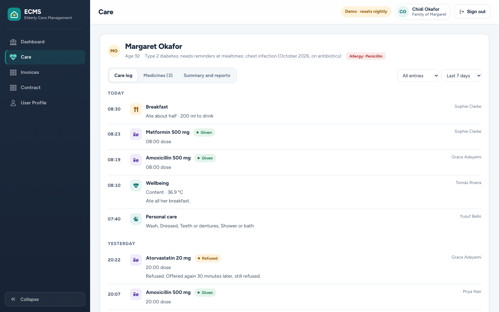

# Elderly Care Management System (ECMS)

[](https://github.com/helena-byte999/ecms/actions/workflows/ci.yml)

A full-stack web application for a residential care home: caregivers record medicines and daily care, families follow their relative's care with their own login, and managers see what's happening, alongside the contracts, rotas and invoices that run the home.

**Live demo: [ecms-omega.vercel.app](https://ecms-omega.vercel.app)** · try it as an administrator, caregiver or family member, no sign-up needed ([details](#try-the-demo))
**Stack:** React · Sass · Node.js · Express · MongoDB

> This started as an undergraduate team project. This repository is my copy, rebuilt and documented for my portfolio. See [Team & my role](#team--my-role) and the [requirements & design](docs/requirements.md) I wrote.

---

## Overview

ECMS is role-based. Everyone signs in to the same system and sees only what they need:

- **Administrator** manages residents, caregivers, families and other admins, contracts, the weekly rota and invoices, and sees care analytics.
- **Caregiver** runs the daily medicine round, writes the care log, records doctor's visits, and sees their shifts and contract.
- **Family member** has their own read-only login to their relative's care log, medicines, contract and invoices.

Residents are records, not logins: in a care home it's the family who follow along, each with their own account.

## Features

**Care records** (added in 2026, see the [requirements](docs/care-records-requirements.md)):

- **Medicine round**: every dose due today across the home, grouped by time; one tap for *given*, or *refused* / *missed* with a note; late doses stand out
- **Care log**: meals and drinks, personal care, wellbeing (mood, temperature, unwell), activities, incidents and notes, each stamped with who and when. Entries can't be edited or deleted; mistakes are fixed with a visible correction
- **Medicines**: each resident's list with times or "as needed", courses with an end date; stopping one keeps the history
- **Doctor's visits** update the resident's records automatically: medicines started or stopped and changes to allergies and conditions, with a before / after record in the log
- **Care analytics** for admins: doses given and recorded on time, refused and missed doses, incidents and days unwell, each against the previous period; daily trend, outcomes by day or week, incidents by type, mood, staff activity, and a residents table with trend lines, lowest completion first
- **Reports**: a care summary per resident (doses given, refused, missed and not recorded; incidents; visits; wellbeing; meals) and the analytics, as **PDF and CSV**
- **Family access**: each relative gets their own read-only login, linked to one resident, and sees their relative's **key worker** and who's on shift today
- **Team admins**: admins can add other admins; you can't deactivate yourself or the last admin

**Running the home:**

- **Role-based dashboards** with server-side permission checks: people only ever see their own records
- **People**: resident profiles with allergies, conditions, GP, next of kin and emergency contact; caregivers; admins. Admins can edit them (changing an email keeps that person's invoices and rotas linked)
- **Deactivate / reactivate** accounts: records are kept, the person can't sign in and is left off new rotas
- **Contracts**: valid, expired and "no contract" at a glance, with end dates and a per-person history
- **Automatic weekly rota** from every active caregiver: shares differ by at most one shift, nobody works the same day twice, and caregivers per day is adjustable
- **Invoices** for each resident's care: due dates, paid / unpaid / overdue status, one-click "mark as paid", editable, in the care home's currency, and **downloadable as PDF** by admins and families
- **Passwords**: everyone can change their own; admins can set a temporary one
- **Search, sortable columns and paging** across the whole list, not just the visible page
- **Responsive**: on phones, tables turn into readable cards
- **Demo mode**: sample data, one-click role sign-in, nightly reset

## Screenshots

| Homepage | Sign in (demo) |
|----------|---------|
|  |  |

| Admin dashboard | Care analytics |
|-----------------|----------------|
|  |  |

| Medicine round (caregiver) | Care log (family member's view) |
|----------------------------|---------------------------------|
|  |  |

| Caregiver dashboard (medicine round, own shifts highlighted) | On a phone |
|--------------------------------------------------------------|------------|
|  |  |

_Screenshots use made-up demo data._

## Try the demo

On the sign-in page, choose **administrator**, **caregiver** or **family member**. You can also sign in normally:

| Role | Email | Password |
|------|-------|----------|
| Administrator | `admin@example.com` | `ecms-demo` |
| Caregiver | `caregiver@example.com` | `ecms-demo` |
| Family member (Margaret Okafor's daughter) | `family@example.com` | `ecms-demo` |

Everything in the demo is fictional sample data and resets every night (03:00 UTC), so feel free to add, change or deactivate things. Through the day the sample staff keep recording routine care, leaving the most recent doses for you to record on the medicine round. Look at Margaret Okafor for a doctor's visit that started antibiotics. The demo accounts can't be deactivated or have their email, role or password changed, so they always work for the next visitor. The demo server sleeps when idle, so the first sign-in can take up to a minute.

## Adding people

Everyone is added by an admin, from **People** in the menu:

| Who | Where | What they need |
|-----|-------|----------------|
| Resident | People → **Residents** → *Add resident* | Name, email, date of birth, address, phone, GP, next of kin. Optionally a **key worker**. Residents don't sign in, so there's no password. |
| Family member | People → Residents → open the resident (eye icon) → **Family members** → *Add family member* | Name, relationship, email, phone and a temporary password. They sign in at `/login` and see only that resident. |
| Caregiver | People → **Caregivers** → *Add caregiver* | Name, email, phone, date of birth, address, staff type, next of kin, emergency contact and a temporary password. |
| Admin | People → **Admins** → *Add admin* | Name, email, phone, date of birth, address and a temporary password. |

- To set or change a resident's key worker, open the resident and pick from **Key worker**.
- Share temporary passwords privately. People change them from their profile (top-right menu).
- On a new deployment the first admin is created from `ADMIN_EMAIL` and `ADMIN_PASSWORD` (see [Environment variables](#environment-variables)).
- In the demo, anything you add disappears at the nightly reset.

## Tech stack

| Layer | Technology |
|-------|-----------|
| Frontend | React 17 (Create React App), React Router, reactstrap, Sass |
| Backend | Node.js 22, Express |
| Database | MongoDB with Mongoose 8 |
| Auth & security | JSON Web Tokens, bcrypt, role checks, helmet, rate-limited sign-in |
| Testing & CI | 100 API checks against a throwaway MongoDB, run by GitHub Actions on every push |
| Hosting | Vercel (frontend), Render (API), MongoDB Atlas (database) |

## Requirements, UML and data model

The [requirements & design document](docs/requirements.md) has the original 2022 requirements, use-case, ER and class diagrams. Next to them are updated diagrams of the system as built, and a table of which use cases are done. In short:

- **User**: name, email, role (admin / caregiver / client, i.e. resident / family), status (active / on-leave / in-active), contact details, medical details (allergies, conditions, GP); contains **Contracts**, **Next of Kin** and **Emergency Contact**. Family members link to one resident; residents don't sign in
- **Invoice**: the resident's email, amount, type, description, due date, status
- **Schedule**: week, dates, and the caregivers on duty each day
- **Medication**: resident, name, dose, times or "as needed", course dates, who added or stopped it and why, and the doctor's visit that started it
- **CareEntry**: resident, type (dose, meal, personal care, wellbeing, activity, incident, note, doctor's visit), when, author, details, and the entry it corrects

## Team & my role

This was a group project by **Ena Otuokon** (me), **Munachi Umeh**, **Hassan Hassan** and **Abdulhamid Tukur**, supervised by **Alexey Vedishchev**, and presented on 2 December 2022. The original team repository is [NabsCodes/ecms](https://github.com/NabsCodes/ecms).

**My part in the 2022 project:**
- **Research and requirements**: researched existing care management systems and wrote the requirements specification ([see it](docs/requirements.md))
- **UML**: produced the use-case, ER and class diagrams ([see them](docs/requirements.md#original-diagrams-2022))
- **Database**: designed the MongoDB data model
- **Frontend**: led the UI/UX and built the React views

**The 2026 rebuild:** I turned the project into a live product as product owner, building with Claude Code. I benchmarked the market, wrote the [care records requirements](docs/care-records-requirements.md), and decided what to build and what to leave out. That work added the medicine round, care records, doctor's visits, family logins and care analytics, plus the security fixes, tests and deployment.

## Running locally

**Prerequisites:** Node.js 22 and a MongoDB database (local, or a free [MongoDB Atlas](https://www.mongodb.com/atlas) cluster).

```bash
git clone https://github.com/helena-byte999/ecms.git
cd ecms

# API
cd server
cp .env.example .env        # fill in the values (see below); set DEMO_MODE=true for sample data
npm install
npm run dev                 # http://localhost:5001

# Frontend (second terminal)
cd client
cp .env.example .env        # set REACT_APP_DEMO=true to show the demo buttons
npm install
npm start                   # http://localhost:3000
```

### Tests

```bash
cd server
npm test    # API, care records and demo suites against a throwaway MongoDB; no setup needed
```

## Deploying

1. **Database: MongoDB Atlas.** Create a free cluster and a database user. Under *Network Access*, allow `0.0.0.0/0`, because Render's addresses change. Copy the `mongodb+srv://…` connection string.
2. **API: Render.** *New → Blueprint*, then pick this repo. [`render.yaml`](render.yaml) sets everything up. Paste the Atlas string into `mongoURLProduction`; leave `FrontEndHostProduction` for step 4.
3. **Frontend: Vercel.** Import the repo and set **Root Directory** to `client`. Add `REACT_APP_BackEndHost` (your Render URL), `REACT_APP_DEMO=true` and `REACT_APP_CURRENCY`, then deploy.
4. Back in Render, set `FrontEndHostProduction` to your Vercel URL (no trailing slash) so the API accepts its requests.
5. **Keeping the demo awake (optional, free).** On Render's free plan the API sleeps after 15 minutes without traffic, and the next visitor waits about a minute. [`keep-awake.yml`](.github/workflows/keep-awake.yml) checks in every 5 minutes from 06:00 to 23:00 UTC. It only runs in the daytime because free plans share 750 server hours a month per Render workspace; change the hours if ECMS is your only free service. Change the URL in that file to your own API.

### Environment variables

`server/.env`

| Variable | Description |
|----------|-------------|
| `LocalPort` | Port for the API locally, e.g. `5001` |
| `mongoURL` / `mongoURLProduction` | MongoDB connection strings for local and production |
| `jwtSecret` | Secret used to sign sign-in tokens (any long random string) |
| `FrontEndHostProduction` | Production frontend URL; the only other origin the API accepts |
| `ADMIN_EMAIL` / `ADMIN_PASSWORD` | Creates the first admin on startup if none exists (accounts can only be created by an admin) |
| `DEMO_MODE` | `true` for a public demo: sample data, one-click demo sign-in, nightly reset. **Never on a database with real care records.** |
| `DEMO_PASSWORD` | Password for the demo accounts (default `ecms-demo`) |
| `HOME_TIMEZONE` | The care home's time zone for medicine times (default `Europe/London`) |
| `LOGIN_RATE_LIMIT` | Sign-in attempts allowed per IP per 15 minutes (default 20) |
| `ROTA_PER_DAY` | Default caregivers per day when generating a rota (default 5) |

`client/.env`

| Variable | Description |
|----------|-------------|
| `REACT_APP_BackEndHost` | URL of the API |
| `REACT_APP_DEMO` | `true` shows the "Try as …" buttons (needs `DEMO_MODE=true` on the API) |
| `REACT_APP_CURRENCY` | Currency for invoices, as an ISO code (`GBP`, `NGN`, `USD`…). Each deployment serves one care home, so it's set per deployment. Default `GBP`. |
| `REACT_APP_LOCALE` | Number and date formatting, e.g. `en-GB`, `en-NG`. Default `en-GB`. |
| `REACT_APP_ORG_NAME` / `REACT_APP_ORG_LINE` | Care home name and tagline at the top of invoice PDFs. Default `ECMS` / `Elderly Care Management`. |

> Real secrets are never committed. Only `.env.example` templates are tracked, and `.env` is gitignored.

## Credits

Icons for care, medicines and people: [Health Icons](https://healthicons.org), public domain (CC0).

Care-home footage on the landing page: [Pexels video 7522210](https://www.pexels.com/video/7522210/), used under the [Pexels licence](https://www.pexels.com/license/).

## License

No license was specified on the original project, so all rights remain with the original authors. This copy is published for portfolio and educational purposes.
