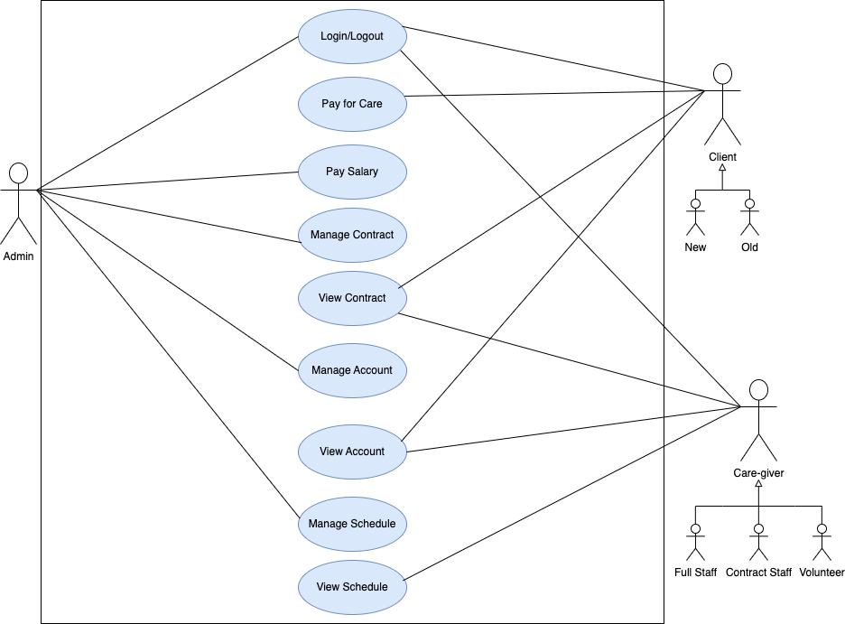
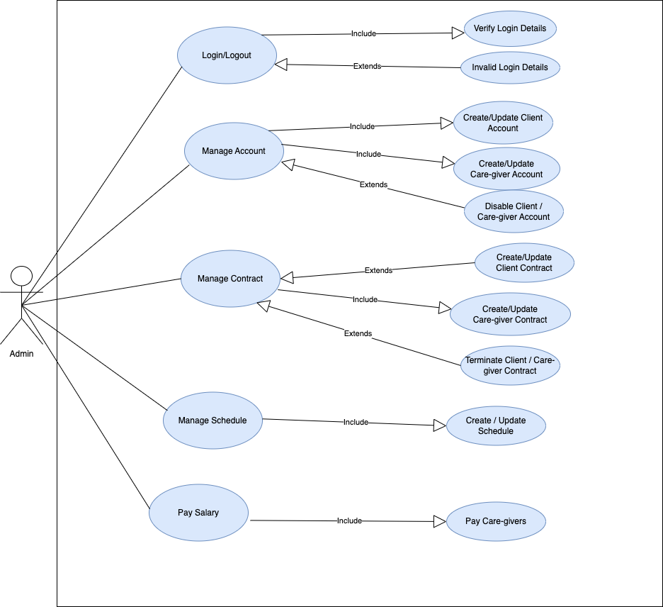
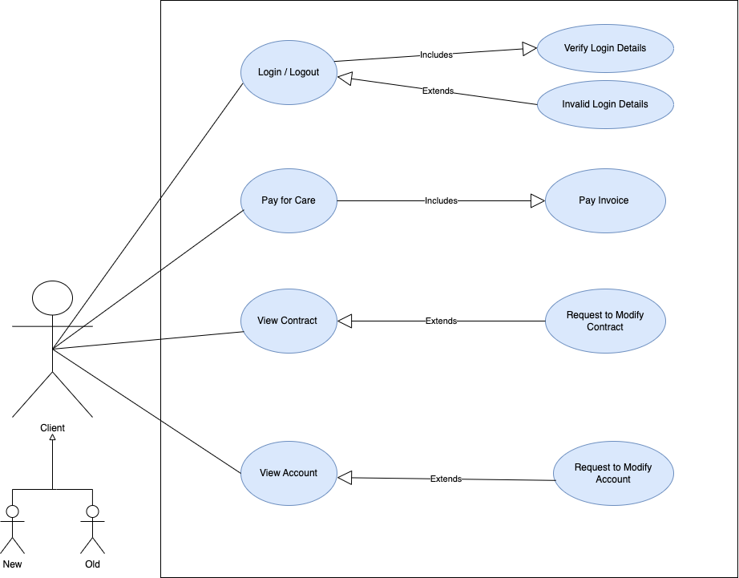
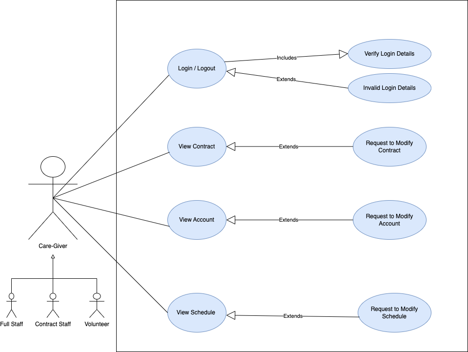
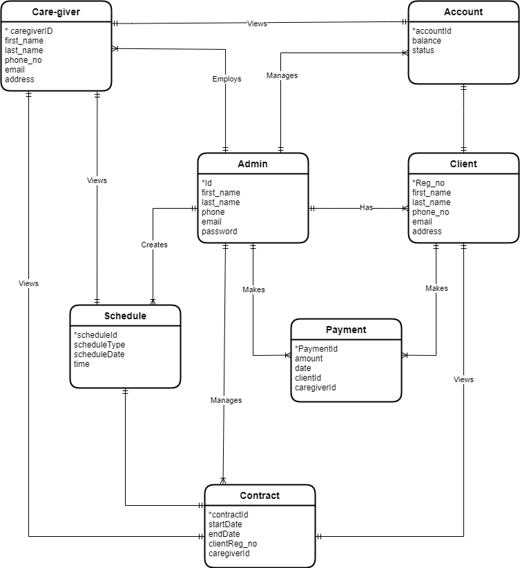
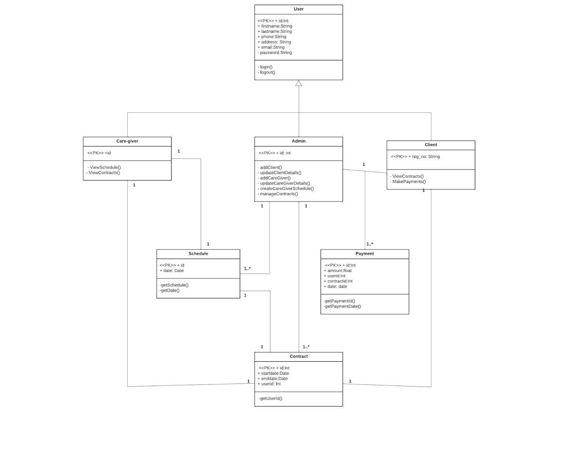
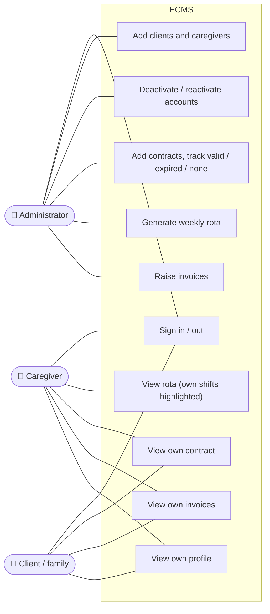
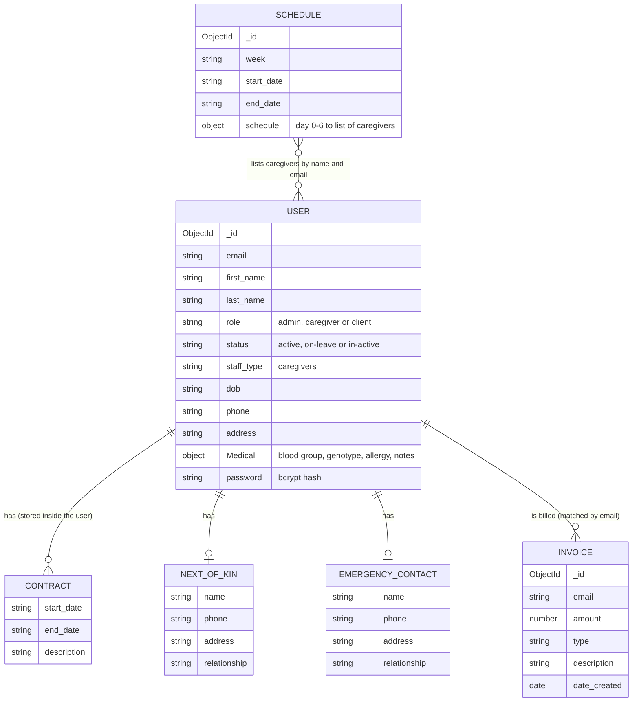
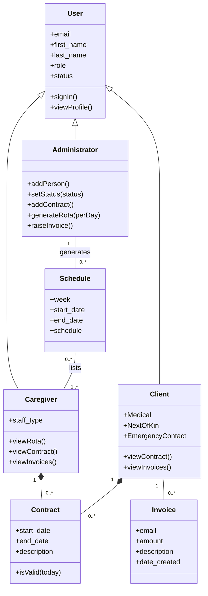

# Requirements & design

ECMS started as an undergraduate team project, presented on 2 December 2022. I led the frontend, the database design, the UML diagrams and this requirements documentation. This page keeps the original 2022 requirements and diagrams, and adds updated diagrams showing how the system works today.

- [Problem](#problem)
- [Objectives](#objectives)
- [Stakeholders](#stakeholders)
- [User journey](#user-journey)
- [Use cases: designed vs built](#use-cases-designed-vs-built)
- [Original diagrams (2022)](#original-diagrams-2022)
- [The system as built (2026)](#the-system-as-built-2026)
- [What changed from the design, and why](#what-changed-from-the-design-and-why)
- [Future work](#future-work)

## Problem

A residential elderly care home kept its records of clients, caregivers, contracts, rotas and billing in ways that didn't scale. As the number of residents grew, so did the need for care, and poor record-keeping caused problems to escalate.

The home needed:

1. **An online platform for the administrator** to register clients and caregivers, keep their records, create their contracts, and build caregivers' schedules.
2. **An online platform for caregivers and clients** where caregivers can see the schedule the administrator created, and both can view their own account and contract.

## Objectives

- Help the administrator manage caregiver and client accounts, caregiver schedules, contracts and invoices in one place.
- Let elderly people, or the family members acting for them, view the services they receive.
- Improve communication between the administrator and caregivers: the administrator manages schedules, and caregivers see them as soon as they're published.

## Stakeholders

| Stakeholder | What they need |
|---|---|
| **Administrator** | Register and maintain clients and caregivers, manage contracts, build the weekly rota, raise invoices |
| **Caregiver** (full staff, contract staff, volunteers) | See their shifts and their own contract and account |
| **Client** (new and existing residents, and their families) | See their contract, account details and invoices |

## User journey

The 2022 scenario, and where each step stands today:

| # | Step | Status |
|---|---|---|
| 1 | Administrator signs in | ✅ Built |
| 2 | Administrator creates accounts for clients and caregivers | ✅ Built |
| 3 | Administrator creates contracts for clients and caregivers | ✅ Built |
| 4 | Clients and caregivers sign in | ✅ Built |
| 5 | Clients and caregivers view their account and contract | ✅ Built |
| 6 | Client pays for care | ⏳ Not built: invoices are records; no payment processing |
| 7 | Administrator creates the caregivers' schedule | ✅ Built: one-click weekly rota |
| 8 | Caregiver views their schedule | ✅ Built, with their own shifts highlighted |
| 9 | Administrator pays caregivers' salaries | ⏳ Not built |

## Use cases: designed vs built

| Actor | Use case (2022 design) | Status today |
|---|---|---|
| All | Log in / log out, verify login details, handle invalid login | ✅ Built. Same message for unknown email or wrong password, and repeated attempts are rate-limited |
| Admin | Create / update client account | ✅ Create. Updating other people's details isn't in the UI yet |
| Admin | Create / update caregiver account | ✅ Create. Updating isn't in the UI yet |
| Admin | **Disable client / caregiver account** | ✅ **Built as deactivate / reactivate.** Records are kept, the person can't sign in, and they're left off new rotas |
| Admin | Create / update client and caregiver contracts | ✅ Create. A new contract becomes the current one |
| Admin | Terminate contract | ⏳ Not built (contracts end on their end date) |
| Admin | Create / update schedule | ✅ Generate or regenerate a week's rota from every active caregiver |
| Admin | Pay salary | ⏳ Not built |
| Client | View contract, view account | ✅ Built |
| Client | Pay for care / pay invoice | 🟨 Invoices can be viewed, not paid |
| Client, Caregiver | Request to modify contract / account / schedule | ⏳ Not built |
| Caregiver | View schedule | ✅ Built |

## Original diagrams (2022)

These are the diagrams from the 2022 design, unchanged.

**Use cases: overview**

| Administrator | Client | Caregiver |
|---|---|---|
|  |  |  |

**Entity-relationship diagram**

**Class diagram**

## The system as built (2026)

### Use cases

### Data model

One `User` collection holds all three roles. Contracts, next of kin and emergency contact are stored inside each user's record.

### Classes and responsibilities

## What changed from the design, and why

| 2022 design | As built | Why |
|---|---|---|
| Separate Admin, Client and Caregiver tables | One `User` collection with a `role` field | One sign-in flow and one permission check for everyone; roles share most fields |
| Contract as its own table | Contracts stored inside each user | A person's contracts are always read together with that person; the newest contract is the current one |
| Payment and Account tables | Invoices only (no payments or balances) | Payment processing was out of scope for the build |
| Schedule linked to contracts | A weekly rota listing caregivers per day | Simpler to generate and read; every active caregiver gets a fair share of shifts |
| "Disable account" use case | `status`: active, on-leave, in-active | Deactivation keeps records (needed for care and billing history) and blocks sign-in |

## Future work

From the 2022 presentation:

- Analysis and reporting directly in the system
- Updating medical records automatically after each doctor's visit
- Rolling out to elderly care homes in Nigeria (supported today by setting the currency, e.g. `REACT_APP_CURRENCY=NGN`)

Added since:

- Editing people's details from the admin screens, and terminating contracts early
- Invoice status (paid / unpaid) and due dates; online payment
- "Request a change" for clients and caregivers
- Password reset
- Linking invoices to users by ID rather than email
